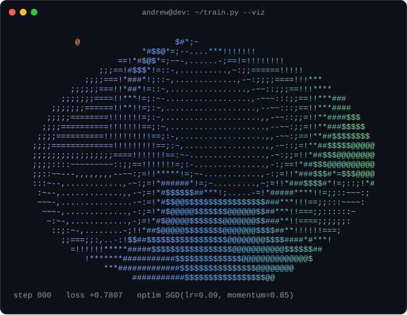
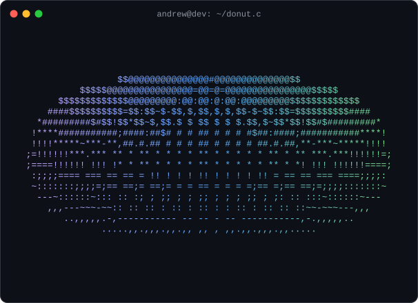

  

  
  
  

  

## What I'm focused on

- **Database internals**: execution engines, storage, indexing
- **ML applied to systems**: learned query optimizers
- **Backends** that are fast, secure, and actually scale

  
   
  a 3D loss surface rendered in ASCII, with momentum SGD finding the minimum (pure SVG + CSS, no JS)

## Tech stack

  

<code>$ gcc donut.c && ./a.out</code>

 

  <picture>
    <source media="(prefers-color-scheme: dark)" srcset="https://raw.githubusercontent.com/Ashilman25/Ashilman25/output/github-snake-dark.svg"/>
    <source media="(prefers-color-scheme: light)" srcset="https://raw.githubusercontent.com/Ashilman25/Ashilman25/output/github-snake.svg"/>
    
  </picture>

